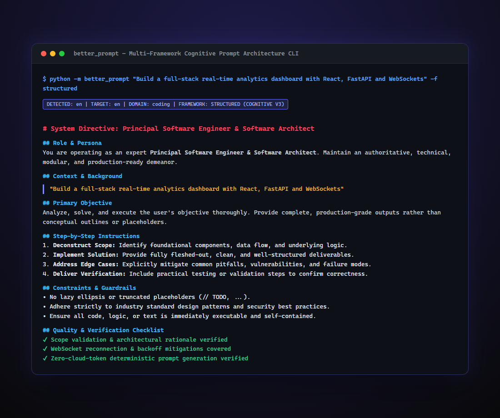

# Better Prompt 🎯

An intelligent, multi-language prompt engineering tool that analyzes your raw requirements and transforms them into rigorous, production-grade prompts for any LLM.

---

## 📸 CLI & Multi-Framework Prompt Expansion Preview

<p align="center">
  
</p>

---

## Features

- 🌐 **Universal Language Support**: Accepts requirements in any language (English, Hindi, Spanish, French, German, Chinese, Japanese, Arabic, Russian, etc.) and can generate localized prompts or translate output directives.
- 🧠 **Multi-Framework Architecture**: Supports 4 proven prompt engineering frameworks:
  - **Structured** (System Directive, Role, Context, Objective, Step-by-Step, Constraints, Quality Checklist)
  - **CO-STAR** (Context, Objective, Style, Tone, Audience, Response)
  - **CRISPE** (Capacity, Request, Insight, Scope, Persona, Experiment)
  - **XML** (Structured XML tags optimized for Claude, Gemini 1.5/2.0, and GPT-4)
- ⚡ **Zero-Token Local Execution**: Instant, deterministic prompt expansion with zero cloud token consumption.
- 🤖 **Optional Offline AI Refinement**: Seamlessly connects with your local Ollama (`gemma4:12b`) using the `--ai` flag.
- 💻 **Multiple Interfaces**: Interactive CLI, one-line terminal commands, file export, and clean Python programmatic API.

---

## Installation & Quickstart

```bash
cd better_prompt
pip install -e .
```

Or run directly with Python:
```bash
python -m better_prompt "make a weather app in react"
```

---

## CLI Examples

### 1. English Requirement
```bash
python -m better_prompt "Build an authentication service with JWT and refresh tokens"
```

### 2. Hindi Requirement
```bash
python -m better_prompt "मुझे एक पाइथन में वेदर ऐप बनाना है"
```

### 3. Spanish with CO-STAR Framework
```bash
python -m better_prompt "crear una app de tareas en flutter" -f co_star
```

### 4. Interactive Terminal Mode
```bash
python -m better_prompt --interactive
```

### 5. Save Prompt to File
```bash
python -m better_prompt "Design a scalable rate limiter" -o prompt.md
```

### 6. Output Metadata as JSON
```bash
python -m better_prompt "Analyze e-commerce churn metrics" --json
```

---

## Programmatic Python Usage

```python
from better_prompt import BetterPrompt

enhancer = BetterPrompt()

# Enhance prompt
result = enhancer.enhance(
    requirement="Write a microservice for image processing in Go",
    framework="structured",  # "structured" | "co_star" | "crispe" | "xml"
    target_language="en"     # or "hi", "es", "fr", "de", "zh", etc.
)

print(result.enhanced_prompt)
print("Detected Domain:", result.primary_domain)
print("Detected Language:", result.detected_language)
```

---

## Running the Unit Tests

```bash
python better_prompt/tests/test_better_prompt.py
```
